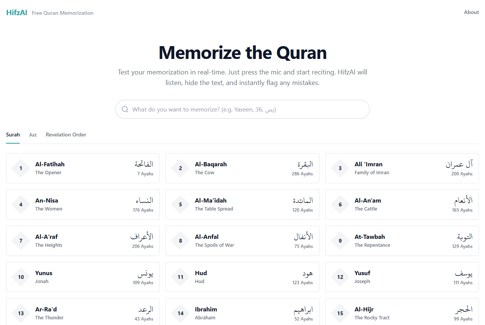
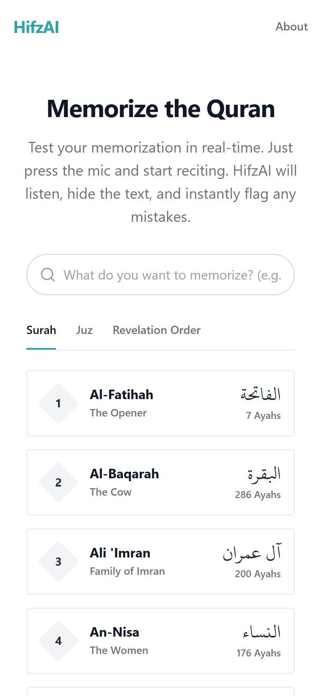

# HifzAI — Free, Open-Source Quran Memorization

[](https://github.com/UmairBasharti/hifzquran/actions/workflows/ci.yml)

**HifzAI** is a free, open-source Quran memorization (Hifz) web app that helps you test and strengthen your memorization in real time. Press the mic, recite from memory — HifzAI listens, hides the text, and reveals each word as you get it right, instantly flagging mistakes.

Inspired by [Tarteel AI](https://tarteel.ai)'s approach to recitation feedback, built as a free, open-source alternative for the global Muslim community at zero cost.

> **Privacy first**: HifzAI processes all audio in memory only and discards it immediately after transcription — no audio is ever stored anywhere.

---

## Screenshots

<p align="center">
  
  &nbsp;
  
</p>

---

## Features

- **Surah search & selection** — all 114 Surahs, searchable by name, number, or Arabic
- **Custom ayah range** — choose exactly which ayahs to practice (e.g., Ayah 3 to 7)
- **Three session modes**:
  - 🎧 **Listen** — follow along with professional Qari recitation (12 reciters available)
  - 📖 **Read** — read the Uthmani text with word-by-word tracking
  - 🧠 **Memorize (Hifz)** — text hides, reveals word-by-word as you recite correctly
- **Real-time ASR** — Quran-fine-tuned Whisper model transcribes your recitation live
- **Word-by-word feedback** — correct (green), wrong (red), skipped (amber)
- **Tajweed error detection** — identifies missing shadda, wrong harakat, missing tanwin
- **Backtracking** — go back and fix a mistake, the word re-marks as correct
- **Session summary** — detailed word-by-word breakdown with "How to fix it" tips
- **Authentic Mushaf layout** — QCF v1 page fonts render the exact Madani-Mushaf glyphs

---

## Architecture

HifzAI has **two separate processes** that run side by side:

| Process | Tech | Port | Role |
|---------|------|------|------|
| **Frontend** | Next.js 16 (App Router) | 3000 | UI, mic capture, WebSocket client |
| **Backend** | Python FastAPI | 8000 | ASR (faster-whisper), alignment, tajweed |

The browser captures mic audio at 16kHz mono, streams it via WebSocket to the Python backend, which runs a Quran-fine-tuned Whisper model and returns word-by-word results in real time.

---

## Getting Started (from zero)

HifzAI runs on your own computer as **two programs side by side**: a Python **backend** (the speech recognition) and a Next.js **frontend** (the web page you use). You start each one in its own terminal window. No account and no key is needed.

### What you need

| Tool | Version | Download | Check it works |
|---|---|---|---|
| **Git** | any recent | [git-scm.com/downloads](https://git-scm.com/downloads) | `git --version` |
| **Python** | 3.11 or newer (tested on 3.11 and 3.13) | [python.org/downloads](https://www.python.org/downloads/). On Windows, tick **"Add python.exe to PATH"** in the installer | `python --version` (Windows: `py --version`; macOS/Linux: `python3 --version`) |
| **Node.js** | 20.9 or newer (tested on Node 20 and 22; the LTS version is fine) | [nodejs.org](https://nodejs.org) | `node --version` |
| A browser and a microphone | Chrome, Edge, Firefox or Safari | | |

You also need an internet connection the first time: the backend downloads the Quran text (about 24 MB) and the speech model (about 150 MB), once.

> **What is a terminal?** The window where you type commands. On Windows press the Windows key, type **PowerShell** and press Enter. On macOS open **Terminal**. You will need **two** terminal windows, one for each program.

### Step 1: Get the code

```bash
git clone https://github.com/UmairBasharti/hifzquran.git
cd hifzquran
```

No Git? On the GitHub page click the green **Code** button, then **Download ZIP**, unzip it, and open your terminal inside the unzipped folder (it is called `hifzquran-main`).

### Step 2: Start the backend (terminal 1)

```bash
cd backend
```

Create a private Python environment (one time only) and switch it on:

**Windows (PowerShell)**

```powershell
python -m venv venv
.\venv\Scripts\Activate.ps1
```

**macOS / Linux**

```bash
python3 -m venv venv
source venv/bin/activate
```

Your prompt should now start with `(venv)`. If it does not, stop and see [Troubleshooting](#troubleshooting): installing without it puts the packages into your system Python.

Install the packages (one time, takes a few minutes) and start the server:

```bash
pip install -r requirements.txt
python -m uvicorn main:app --host 127.0.0.1 --port 8000
```

The first start downloads the Quran text and the speech model, which takes a few minutes (the window shows progress). It is ready when you see:

```
HifzAI backend ready.
INFO:     Uvicorn running on http://127.0.0.1:8000
```

Leave this window open.

### Step 3: Start the frontend (terminal 2)

Open a **second** terminal, go to the same `hifzquran` folder, then:

```bash
cd frontend
npm install
npm run dev
```

Warnings about "deprecated" packages or "vulnerabilities" during `npm install` are normal and do not affect the app. It is ready when you see `Local: http://localhost:3000`.

### Step 4: Use it

1. Open **http://localhost:3000** in your browser.
2. Search for a Surah (try `Kawthar` or `108`) and click it.
3. Choose **Read** or **Memorize** at the top, press **Start Reciting**, and click **Allow** when the browser asks for the microphone.
4. Recite. Each correct word turns green, wrong words red, skipped words amber.

Two things worth knowing:

- A whole Surah starts with the **Bismillah**, so say it first. To practise from verse 1 only, choose **Range: From 1 To …**; anything other than the full Surah skips the Bismillah.
- Without a graphics card (GPU) words appear a few seconds after you say them, and the very first word takes longer.

### Next time

You only repeat the start commands, not the installs. Terminal 1: `cd hifzquran/backend`, switch the environment on again (`.\venv\Scripts\Activate.ps1` or `source venv/bin/activate`), then `python -m uvicorn main:app --host 127.0.0.1 --port 8000`. Terminal 2: `cd hifzquran/frontend`, then `npm run dev`. Stop either one with **Ctrl+C**.

> **Windows shortcut**: after step 2's one-time setup, `.\start_backend.ps1` and `.\start_frontend.ps1` (run from the `hifzquran` folder, one per terminal) do the same. They listen on all network interfaces.
>
> **Docker**: the backend also ships a `Dockerfile` in `backend/`. It is written for NVIDIA GPU hosts such as Hugging Face Spaces, uses the CUDA image that faster-whisper documents, and has not been built or tested here.

### Troubleshooting

| What you see | What to do |
|---|---|
| `python` is not recognized (Windows) | Use `py` instead (`py -m venv venv`), or reinstall Python and tick **Add python.exe to PATH**. |
| PowerShell says **"running scripts is disabled on this system"** when you switch the environment on | Windows blocks scripts by default. Run `Set-ExecutionPolicy -Scope CurrentUser -ExecutionPolicy RemoteSigned`, answer **Y**, then close and reopen PowerShell. Or use **Command Prompt** (`cmd`) and run `venv\Scripts\activate.bat` instead. |
| The prompt does **not** start with `(venv)` | The environment is off. Fix it (previous row) before running `pip install`. |
| `pip install` fails | Check `python --version` (3.11 or newer; versions newer than 3.13 are untested). Update pip with `python -m pip install --upgrade pip` and try again. |
| Backend says "address already in use" (Windows: `[Errno 10048] … only one usage of each socket address`) | Another program is using port 8000. Close it, or start the backend with `--port 8001` and create `frontend/.env.local` containing `NEXT_PUBLIC_PYTHON_BACKEND_URL=http://127.0.0.1:8001` and `NEXT_PUBLIC_PYTHON_BACKEND_WS=ws://127.0.0.1:8001`, then restart the frontend. |
| Stuck on "Fetching Quran data…" at the first start | It downloads once from api.quran.com and needs internet. Wait a couple of minutes. Later starts say "loaded from cache". |
| The browser says the microphone is blocked | Browsers only allow the microphone on `http://localhost:3000` or an `https://` address. Open the app at `localhost`, not at your computer's network address, and click **Allow**. |
| I press Start Reciting and nothing appears | On a computer without a GPU, wait a few seconds (the first word is slower). Check terminal 1: it should still say `HifzAI backend ready` and show no errors. |
| My words do not turn green on a whole Surah | A whole Surah expects the Bismillah first. Say it, or choose a **Range** (step 4). |
| Backend log says `WebSocket rejected: invalid origin` | You opened the app at an address the backend does not know. Add that address (for example `http://192.168.1.20:3000`) to `ALLOWED_ORIGINS` in `backend/.env`, comma-separated, and restart the backend. |
| A Surah page says **"Something went wrong … fetch failed"** | The frontend cannot reach the backend. Check terminal 1: it must be running and say `HifzAI backend ready` (after you start it, give it a few seconds). |

---

## Configuration and Keys

**You do not need any account or key to run HifzAI.** Everything below is optional. To change a setting, copy the template and edit the copy, then restart that program:

```bash
# inside backend/    (Windows PowerShell: Copy-Item .env.example .env)
cp .env.example .env

# inside frontend/   (Windows PowerShell: Copy-Item .env.example .env.local)
cp .env.example .env.local
```

`.env` files are ignored by Git, so your settings and keys are never committed.

### Backend settings (`backend/.env`)

| Setting | Default | What it does |
|---|---|---|
| `ALLOWED_ORIGINS` | `http://localhost:3000,http://127.0.0.1:3000` | Web addresses allowed to use the backend, comma-separated. Add yours if you open the app from another address or deploy it. (If the setting is absent, the code also allows hifzai.com and quran.com.) |
| `MODEL_NAME` | `OdyAsh/faster-whisper-base-ar-quran` | The speech model downloaded from Hugging Face. |
| `QURAN_API_BASE_URL` | `https://api.quran.com/api/v4` | Where the Quran text is downloaded from (first start only). |
| `ASR_DEVICE`, `ASR_COMPUTE_TYPE` | automatic | Force `cuda` or `cpu`, and `float16` or `int8` (see [GPU Support](#gpu-support)). |
| `MAX_CONCURRENT_SESSIONS` | `10` | How many recitation sessions may run at the same time. |
| `DEBUG_ASR` | `0` | Set to `1` to print what the model hears (the text and the loudness, never the audio) in the backend terminal. |
| `SUPABASE_URL`, `SUPABASE_SERVICE_ROLE_KEY` | empty | Optional: store finished sessions (next section). |

The server port is not a setting: it is chosen with `--port` when you start the server.

### Frontend settings (`frontend/.env.local`)

| Setting | Default | What it does |
|---|---|---|
| `NEXT_PUBLIC_PYTHON_BACKEND_URL` | `http://127.0.0.1:8000` | Where the frontend finds the backend (HTTP). |
| `NEXT_PUBLIC_PYTHON_BACKEND_WS` | `ws://<the address in your browser>:8000` | The backend's WebSocket address (the live audio connection). |
| `PYTHON_BACKEND_URL` | not set | Like the first one, but for the server side of the frontend only (useful when deployed). |
| `NEXT_PUBLIC_SITE_URL` | `http://localhost:3000` | The site's public address, used for link previews once deployed. |
| `NEXT_PUBLIC_SUPABASE_URL`, `NEXT_PUBLIC_SUPABASE_ANON_KEY` | empty | Not used by the current code. |

### Optional: save finished sessions with Supabase

This is the only place in the project that uses keys. After a session, **Save Session** stores only the counts and the word results (no audio, no name) in a table in your own [Supabase](https://supabase.com) project. Without Supabase, sessions are simply not stored and everything else works.

1. **Create a project.** Make a free account at [supabase.com](https://supabase.com), click **New project**, pick a name and a region, and set a database password (HifzAI does not need it).
2. **Create the table.** Open **SQL Editor → New query**, paste the whole contents of [`backend/db/schema.sql`](backend/db/schema.sql), and click **Run**. You should see a success message. It is safe to run again.
3. **Copy two values** from the Supabase dashboard (Supabase moves these pages around now and then; if you cannot find them, search the dashboard for "API keys"):
   - **Project URL**: **Project Settings → Data API → Project URL**, like `https://abcdefgh.supabase.co`.
   - **Secret key**: **Project Settings → API Keys**, the **secret** key (it starts with `sb_secret_`). On older projects that only show **Legacy API Keys**, use the `service_role` key there.
4. **Put them in `backend/.env`** (copy the template first, see above):

   ```env
   SUPABASE_URL=https://YOUR-PROJECT.supabase.co
   SUPABASE_SERVICE_ROLE_KEY=your-secret-key
   ```

5. **Restart the backend**, finish a session in the app and press **Save Session**. In Supabase open **Table Editor → hifz_sessions**: you should see one new row.

> **Keep the secret key secret.** It can do anything to your database. Put it only in `backend/.env`: never in the frontend, never in a variable starting with `NEXT_PUBLIC_`, and never in a commit. Do not use the publishable (or `anon`) key here.

---

## Project Structure

```
hifzquran/
├── frontend/                      # Next.js 16 (App Router, JavaScript only)
│   ├── app/
│   │   ├── page.js                # Home — Surah search & selection
│   │   ├── hifz/[id]/page.js      # Hifz session page
│   │   └── api/session/route.js   # Session save proxy
│   ├── components/
│   │   ├── HifzSession/           # Core session UI (HifzSession, WordRenderer, AudioPlayer, SessionSummary)
│   │   └── SurahSelector/         # Surah search grid
│   ├── lib/                       # Audio capture, WebSocket, Quran data helpers
│   └── public/
│       ├── audio-processor.js     # AudioWorklet for mic capture
│       ├── fonts/                 # Uthmani + QCF page fonts (604 woff2 files)
│       └── surah_index.json       # 114 surah metadata
│
└── backend/                       # Python FastAPI
    ├── main.py                    # Server entry + REST endpoints
    ├── websocket_handler.py       # WebSocket session handler
    ├── asr/whisper_engine.py      # Whisper model loading + transcription
    ├── alignment/engine.py        # Word-by-word alignment engine
    ├── quran/
    │   ├── loader.py              # Quran data fetcher + cache
    │   └── normalization.py       # Arabic text normalization
    ├── tajweed/checker.py         # Tajweed error classification
    ├── db/schema.sql              # Optional: Supabase table for saved sessions
    └── requirements.txt
```

---

## Tech Stack

| Layer | Technology |
|-------|-----------|
| Frontend | Next.js 16, React 19, Tailwind CSS 4 |
| Backend | FastAPI 0.124.4, Python 3.11+ (tested on 3.11 and 3.13) |
| ASR | faster-whisper 1.2.1 (`OdyAsh/faster-whisper-base-ar-quran`) |
| Quran text | api.quran.com (fetched once at startup, cached locally) |
| Quran fonts | QCF v1 page fonts (Madani Mushaf glyphs) |
| Database | Supabase (optional — for session persistence) |

---

## GPU Support

The backend auto-detects CUDA GPUs. On a GPU, transcription runs in ~0.2s per chunk with beam search (5). On CPU, it uses int8 quantization and greedy decoding to stay responsive. Expect a delay of a few seconds before words appear on a CPU-only machine (the first word takes longer while the model warms up); a CUDA GPU is much faster.

To force a specific device:

```env
ASR_DEVICE=cuda          # or "cpu"
ASR_COMPUTE_TYPE=float16 # or "int8"
```

---

## Testing

```bash
cd backend
python -m pytest -x -v
```

The first run needs an internet connection: it downloads the Quran text once (about a minute) if the server has not already done so, and the ASR tests (`test_asr_golden.py`, `test_asr_silence.py`) load the Whisper model, which is downloaded once as well. Later runs reuse both.

Test order follows the PRD — start with the shortest Surahs:
1. Al-Kawthar (108 — 3 ayahs)
2. Al-Ikhlas (112 — 4 ayahs)
3. Al-Falaq (113 — 5 ayahs)
4. An-Nas (114 — 6 ayahs)

---

## Contributing

Contributions are welcome! Please read [`AGENTS.md`](AGENTS.md) before making changes — it contains the full architecture rules, coding standards, and design decisions.

---

## License

[MIT](LICENSE) — fully open source. Built for the Ummah. 🕌
