# Architecture

HifzAI is two programs that run side by side:

| Program | Tech | Port | Job |
|---|---|---|---|
| **Frontend** | Next.js 16 (App Router), React 19, Tailwind CSS 4 | 3000 | Surah picker, session screens, microphone capture, WebSocket client |
| **Backend** | Python, FastAPI | 8000 | Quran text, speech recognition, word alignment, tajweed classification, optional session saving |

Everything that understands speech lives in the backend. The frontend never sees a model, and the backend never serves a page.

## A recitation, end to end

```mermaid
flowchart LR
  mic["Microphone"] --> aw["AudioWorklet<br/>16 kHz mono windows"]
  aw -->|"binary frames"| ws["WebSocket /ws"]
  ws --> latest["Keep only the<br/>newest chunk"]
  latest --> gate["Noise gate<br/>and normalise"]
  gate --> asr["Whisper (Quran fine-tune)<br/>with voice-activity filter"]
  asr --> align["Alignment engine<br/>fuzzy, forward-moving"]
  align --> taj["Tajweed classifier<br/>(only for wrong words)"]
  taj --> out["wordResult messages"]
  out -->|"JSON"| ui["Words turn green,<br/>red or orange"]
```

1. **Capture.** `frontend/public/audio-processor.js` is an AudioWorklet. It resamples the microphone to 16 kHz mono and posts overlapping windows of `Float32` samples to the page. `frontend/lib/audio.js` wraps the microphone and the worklet, and `HifzSession.js` sends each window as a binary WebSocket frame.
2. **Receive.** The backend's receiver task (`websocket_handler.py`) overwrites a single slot with the newest frame. Older frames that were never processed are dropped on purpose.
3. **Gate.** A processor task takes the frame, and if its raw peak is below `0.05` treats it as silence and skips the model entirely. Otherwise it normalises the volume so quiet reciters still work.
4. **Recognise.** `asr/whisper_engine.py` runs faster-whisper with a Quran fine-tuned model (default `OdyAsh/faster-whisper-base-ar-quran`, set with `MODEL_NAME`). Voice-activity filtering is on, and segments Whisper itself marks as probably not speech are thrown away.
5. **Align.** `alignment/engine.py` matches what was heard to the next words of the chosen range and emits one `wordResult` per word it can decide on.
6. **Classify.** When a word is judged wrong, `tajweed/checker.py` names the kind of mistake.
7. **Show.** The browser colours each word as results arrive and, at the end, shows the summary. See the [API reference](API.md) for the exact messages.

The audio is converted to an array, transcribed, and then dropped (`audio_array = None`). It is never written to disk or to a database.

## Starting up

`backend/main.py` loads two things before it reports ready:

1. The Quran data from `backend/quran/quran_data.json`. If the file is missing it is built once from api.quran.com, which takes roughly a minute and a half.
2. The speech model. It uses a GPU when CUDA is available (`float16`, beam search of 5) and otherwise the CPU (`int8`, greedy decoding so each chunk stays fast). `ASR_DEVICE` and `ASR_COMPUTE_TYPE` override the choice.

`GET /health` answers `503` until both are loaded. The session page (`frontend/app/hifz/[id]/page.js`) fetches the surah on the server and shows a "Warming up the recogniser" screen if the backend is still starting.

## How a word is judged

The alignment engine is the part that decides "correct", "wrong" or "skipped". It is deliberately cautious, because a wrong red mark on a correct recitation is worse than a missed one.

| Rule | Value | Why |
|---|---|---|
| Match a heard token to a reference word | edit similarity of at least `0.7` (`0.5` for words of 3 letters or fewer) | The base model never transcribes perfectly, so exact matching would reject good recitation |
| Skip ahead over words the reciter missed | at most 2 words, and only above `0.82` similarity | Long surahs repeat words. A small, strict window stops a coincidental match far ahead from dragging the cursor along |
| Go back to fix an earlier word | up to 5 words back, with a high threshold | Lets the reciter correct themselves, but a stray match cannot pull the cursor back across the passage |
| Flag a word wrong | only after the reciter has been stuck on it for 2.5 seconds | A single noisy chunk never produces a red word |
| Ignore echoes | the last 3 to 4 confirmed-correct words | Windows overlap, so the same words are heard twice |

Before comparing, both texts are normalised in two stages (`quran/normalization.py`):

- **Stage 1** strips every diacritic and folds letter variants (for example alef-wasla `ٱ` becomes `ا`). This answers "did they say the right word?". The Quran's dagger alef is also kept as a plain alef in a second accepted form, because the model often writes that long vowel as a full letter.
- **Stage 2** keeps the diacritics. `tajweed/checker.py` uses it to say what was wrong once the root word matched: `missing_shadda`, `wrong_harakat`, `missing_tanwin`, `wrong_word` or `pronunciation_error`.

A wrong or skipped word stays open: if the reciter goes back and says it properly, it is reported again as `correct`.

## Why it is built this way

- **The newest chunk wins.** Transcribing takes longer on a CPU than the audio lasts. If every chunk were queued, the colours would lag further behind each second. Dropping stale chunks keeps the display tied to what the reciter just said.
- **No hint from the expected text.** An earlier version fed the next ayah to Whisper as a prompt. The model then repeated it back from silence and noise, and words turned green before anyone spoke. The caller still passes the upcoming words, but the decoder ignores them. The model is already Quran-tuned, so it does not need the hint.
- **Two stages of matching.** Splitting "right word?" from "right marks?" lets the app say something useful ("shadda missing") instead of only "wrong".
- **Anonymous by design.** There are no accounts. A saved session is a handful of counts and a list of word outcomes (see [Database](DATABASE.md)).
- **Two processes.** Keeping the model out of the web server means the web side stays light, the backend can run on a GPU machine on its own (the frontend just needs its address), and either side can be tested alone.

## Frontend structure

| Path | Role |
|---|---|
| `app/page.js` | Home: headline, search, surah grid |
| `components/SurahSelector/` | Search (name, number or Arabic) and the grid of 114 surahs, from `public/surah_index.json` |
| `app/hifz/[id]/page.js` | Session page. Fetches the surah on the server and mounts the session component |
| `components/HifzSession/` | The session: `HifzSession` (state and controls), `WordRenderer` (Mushaf glyphs, colours), `AudioPlayer` (Listen mode with reciters), `SessionSummary` |
| `lib/audio.js`, `lib/websocket.js`, `lib/quran.js` | Microphone capture, the WebSocket client with reconnecting, surah search |
| `app/api/session/route.js` | Proxy for saving a finished session |
| `public/fonts/` | Uthmani and page-by-page Mushaf fonts (604 files), so the text matches the printed Madani Mushaf |

There are three modes on the session page: **Listen** (follow a reciter), **Read** (the Uthmani text with word-by-word tracking) and **Memorize** (the text hides and each word reveals as it is recited correctly).

## Backend structure

| Path | Role |
|---|---|
| `main.py` | App setup, CORS, startup loading, `GET /health`, `GET /surah/{n}`, `POST /session`, mounts the WebSocket |
| `websocket_handler.py` | One session per socket: origin check, capacity cap, receiver and processor tasks, silence alert, completion summary |
| `asr/whisper_engine.py` | Model loading, device choice, noise gate, transcription |
| `alignment/engine.py` | The session state and the rules in the table above |
| `quran/loader.py`, `quran/normalization.py` | Building and loading the Quran data, and the two-stage text normalisation |
| `tajweed/checker.py` | Naming the kind of mistake |
| `supabase_db.py`, `db/schema.sql` | Optional session saving |

## Known limits

- Accuracy is that of the base-size model. A larger Quran fine-tune can be used with `MODEL_NAME` on a machine with a GPU.
- On a CPU the result for each window takes a moment. That is why the engine only flags a word after 2.5 seconds instead of at the first mismatch.
- Background noise can still produce odd transcriptions. The noise gate and the voice-activity filter reduce this but do not remove it.
- The tajweed classifier names spelling-level mistakes (shadda, vowel marks, tanwin). It does not judge rules of recitation such as elongation length.
